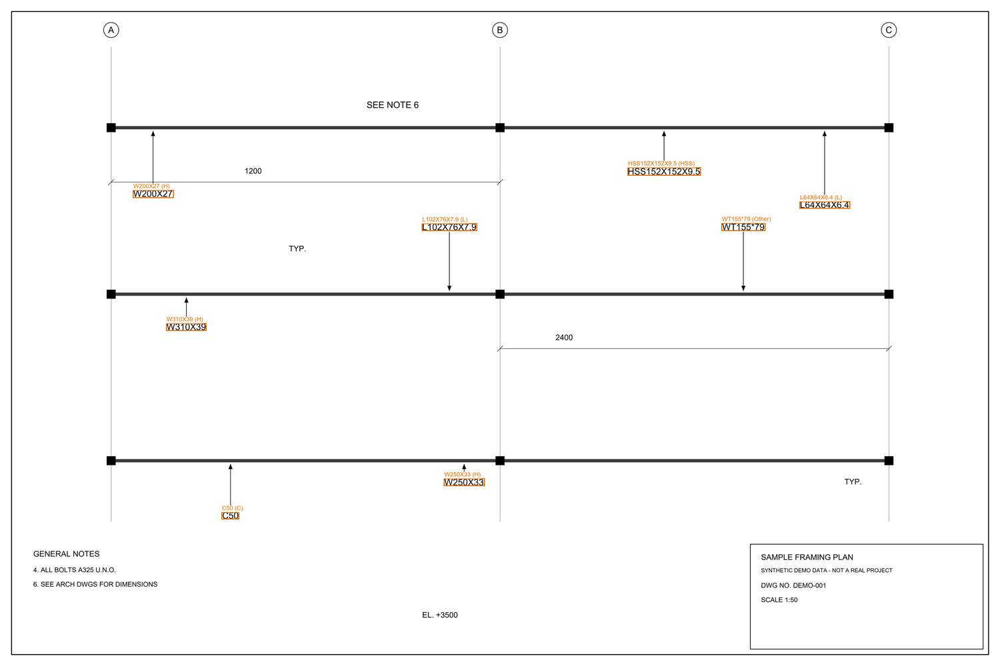
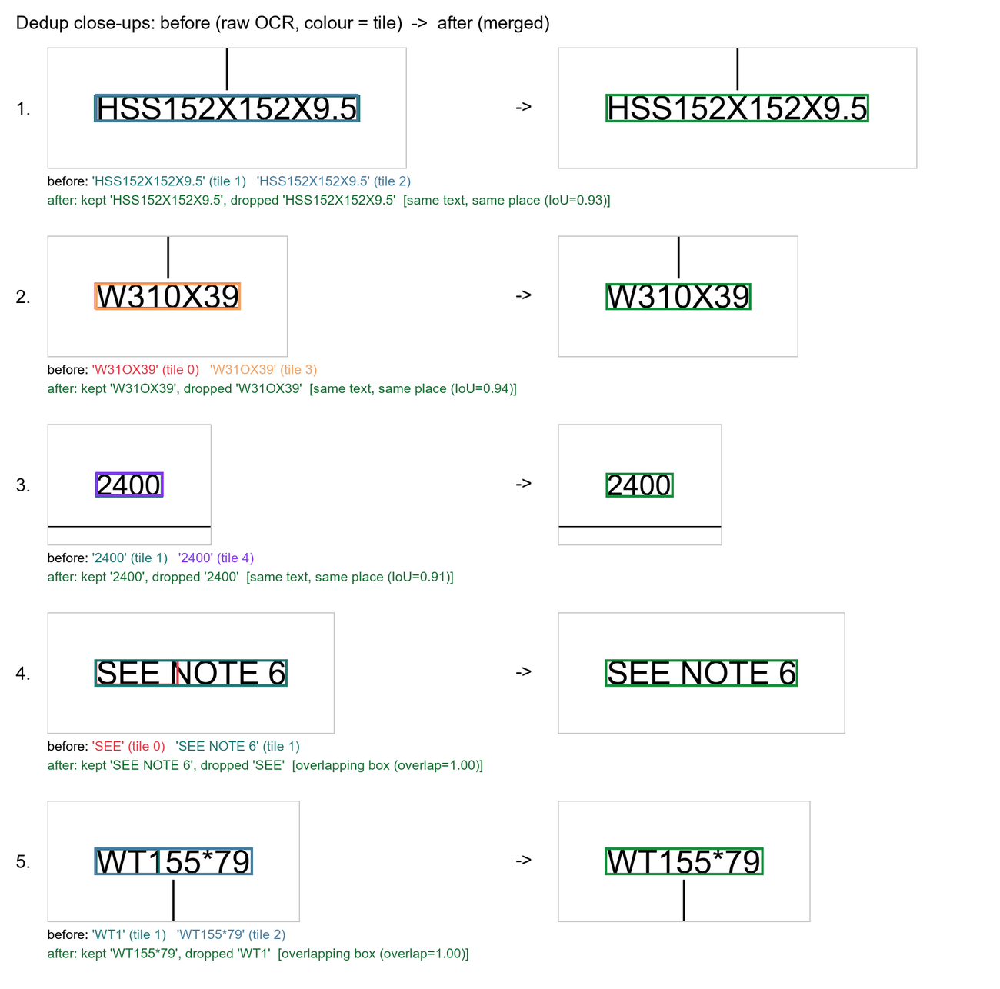

# Steel Drawing Text Extraction

[](https://github.com/raymond0122/steel-drawing-text-extraction/actions/workflows/ci.yml)

A standalone rebuild of my part of a capstone project: reading the text on structural steel drawings and picking out the steel section labels.

## Context

For my final-year capstone, a 4-person team built an 18-stage Python pipeline that turns structural steel drawing PDFs into a bill of materials for an industry sponsor. I owned two pieces:

- **The text-extraction layer:** tiled OCR with Azure Document Intelligence, merging results across tiles, and filtering steel section labels with an LLM.
- **JWT authentication** for the FastAPI backend.

The pipeline was not meant to be right on its own. It extracts as many labels as it can, and a person checks the result before it is used. The sponsor supplied drawings paired with their bill-of-materials spreadsheets, and we checked the pipeline's output against those.

The sponsor's drawings are confidential. So this repository re-implements my part from scratch and runs on a **synthetic drawing** instead. It contains no sponsor data and no code from my teammates' stages (vector parsing, CNN classification, label-to-component linking, the frontend).

## How it works

```
page image ─► overlapping tiles ─► OCR per tile ─► merge + dedup ─► LLM label filter ─► labels with boxes
```

| Tiles (350 px overlap) | Final labels |
|---|---|
|  |  |

Duplicates and fragments created at tile edges, before and after merging:



## Quick start

Install, with Python 3.10 or newer:

```bash
git clone https://github.com/raymond0122/steel-drawing-text-extraction.git
cd steel-drawing-text-extraction
python -m venv .venv
source .venv/Scripts/activate                  # Git Bash on Windows; PowerShell: .venv\Scripts\Activate.ps1; macOS/Linux: source .venv/bin/activate
pip install -e ".[dev]"                        # the app, plus pytest, ruff and mypy for development
```

### See it in the browser (start here)

```bash
uvicorn steel_text.web.server:app              # then open http://127.0.0.1:8000
```

The page runs the whole flow on the synthetic drawing as it opens, offline, with no API keys, and shows each step on the drawing: **1 Tiles**, **2 Raw OCR**, **3 Dedup** and **4 Labels**. Hover a box to see which tile read it and why dedup dropped it; scroll to zoom and drag to pan. Tick **Make OCR tile 1 fail** or **Make LLM batch 1 fail** and run again to see how a gap is shown. A second tab tries out the auth API call by call.


### Or on the command line

```bash
steel-demo                                     # offline: synthetic drawing, simulated OCR and LLM, no API keys
```

It prints a summary and writes an image per step, `labels.json`, `labels.xlsx` (a label list, not a bill of materials) and `dedup_log.txt` to `out/`. It exits with 1 when part of the page was not read or not checked. `python -m steel_text.demo` is the same command.

### Live mode

Live mode calls the real Azure and OpenAI services. Copy `.env.example` to `.env` in the repository root and fill in the keys; `OPENAI_MODEL` picks the model (default `gpt-4o`). Then choose **Live** in the web UI, after **Log in** at the top right, and optionally upload a page image. Or run `steel-demo --live` for the synthetic drawing, or `steel-demo --live --image page.png` for your own page image.

The test sheet the measurements in [docs/DESIGN.md](docs/DESIGN.md) were made on, a synthetic 36 × 24 in steel framing plan at 400 dpi, is in the repository: `steel-demo --live --image experiments/tiling/steel_framing_plan_S-201_400dpi.png`.

### Development

```bash
python -m pytest                               # 154 tests
ruff check . && ruff format --check .          # lint and formatting (drop --check to apply it)
mypy                                           # type check, strict
uvicorn steel_text.web.server:app --reload     # the web UI, restarted on every code change
```

## Key design decisions

- **Built for human review, not a final answer.** Each label keeps its box on the drawing and the raw OCR text, so a reviewer can find it and see what the LLM corrected. The synthetic drawing comes with a ground-truth file, and the demo and web UI report which expected labels were found or missed.
- **Overlapping tiles, sized by measurement.** Large drawings can exceed 10,000 px, the largest image Azure accepts, and shrinking them loses small text. Pages are cut into 3,500 px tiles at full resolution. On a test sheet, tiles up to 4,500 px read as well as smaller ones, and larger tiles read worse ([the numbers](docs/DESIGN.md#why-3500-px)). Tiles overlap by 350 px, more than the longest label on that sheet, so a label crossing a tile edge is whole in one of the two tiles; for a higher-resolution drawing the overlap can be raised ([why 350 px](docs/DESIGN.md#why-350-px)).
- **Duplicates and cut-off pieces from tile edges are merged.** Text in an overlap band is read by two tiles, and text crossing an edge can come back cut off: one tile reads `"SEE"` while its neighbour reads `"SEE NOTE 6"`. Dedup keeps one full reading of each text and logs why it dropped the others. Only text that two different tiles read, inside the area both cover, is compared, so a label printed twice stays twice.
- **The LLM cannot invent locations.** Under a strict JSON schema it returns only an ID and a label. Boxes are joined back from the OCR results by ID, and IDs that weren't in the batch, or repeat, are dropped.
- **Transient errors are retried; what still fails is skipped, and shown.** Azure and OpenAI calls retry on 429, 5xx and network errors, honouring `Retry-After` up to 60 s. OpenAI's 429 for used-up quota or credit is not retried, since waiting won't refill it. An OCR tile or LLM batch that still fails is skipped, and the rest of the page goes on. A tile that wasn't read is hatched red in the web UI and the demo images and listed on a "Not read" sheet in the Excel file. The lines of a skipped LLM batch are marked in the web UI and listed on a "Not checked" sheet. So missing text can't pass for an empty area, and the demo exits with code 1 when anything was skipped. Only a page where no tile can be read fails.
- **Live runs need a login, and tokens can't be swapped.** Live mode spends API credit, so the web UI runs it only for a logged-in user, while the offline demo stays open. Access and refresh JWTs carry a `type` claim, so a refresh token can't stand in for an access token. Login gives the same error, in about the same time, for an unknown user and a wrong password.

Thresholds, retry rules and the web UI are described in [docs/DESIGN.md](docs/DESIGN.md).

## Known limitations

- **Text longer than the overlap** (350 px unless set), such as a long note line, that crosses a tile edge may never be read whole by any tile.
- **A tile that wasn't read can't be retried on its own.** Its area is marked, but reading it means running the whole page again.
- **No jitter in the backoff.**
- **LLM labels aren't validated** against a catalogue of standard steel sections.
- **The tile size, the dedup thresholds and the LLM batch size were measured on one synthetic sheet only,** the batch size with one model (gpt-4o). The sponsor's drawing–spreadsheet pairs are confidential, so every evaluation here uses synthetic drawings.
- **Dedup can't tell a misreading from the correct reading** of the same label. Azure's text lines carry no confidence, so it keeps the longer one, which is sometimes the misreading.
- **No review step.** The web UI shows the results but cannot correct or approve them.
- **Tokens can't be revoked** (they are stateless), and passlib's default PBKDF2 iteration count is below current OWASP guidance.
- **The web UI is for local use only.** It answers only requests addressed to `127.0.0.1` or `localhost`, so a web page elsewhere can't reach it through the visitor's browser (DNS rebinding). Live runs need a login, but anyone who can reach the page can register, so the login doesn't protect the API credit of a public server.

## Layout

```
src/steel_text/          one package, installed with pip install -e .
  pipeline.py            the flow shared by the demo and the web UI: tiled OCR, then the LLM label filter
  tiling.py              split the page into overlapping tiles
  ocr_stage.py           OCR each tile and map its lines back onto the page
  azure_ocr.py           the Azure Document Intelligence client, with retry and backoff
  dedup.py               merge the duplicates and cut-off pieces that tile edges create
  llm_filter.py          pick out the steel labels with the OpenAI API
  geometry.py            box helpers: IoU and overlap ratio
  ocr_types.py           the OCR data types the stages share
  http.py                the slice of an HTTP client the Azure and OpenAI clients use, and the retry and backoff they share
  settings.py            every setting the app reads, from the environment and .env
  page_image.py          open a page image, refusing one too large to decode
  label_sheet.py         write the labels to an Excel list
  demo.py                the steel-demo command: runs the whole flow and writes images to out/
  sample_drawing.py      demo only: the synthetic drawing and its ground truth
  mock_clients.py        demo only: offline stand-ins for Azure OCR and the LLM
  overlay.py, fonts.py   demo only: the step-by-step images
  auth/                  FastAPI app, password hashing and JWT, SQLite user store; guards the web UI's live runs
  web/                   local web UI: a FastAPI server, its response models, and the page (index.html, app.js, style.css)
tests/                   unit tests, an offline end-to-end test, web API tests, and a check that the experiment still runs
experiments/tiling/      the tiling experiment: tiles against a shrunk page, and tile sizes, measured with Azure
experiments/llm_batch/   the LLM experiments: OCR lines per request and the prompt, measured with OpenAI
docs/                    design notes and README images
.github/                 CI: ruff, mypy and pytest on every push to main and every pull request
pyproject.toml           dependencies, the steel-demo command, and the pytest, ruff and mypy settings
```
