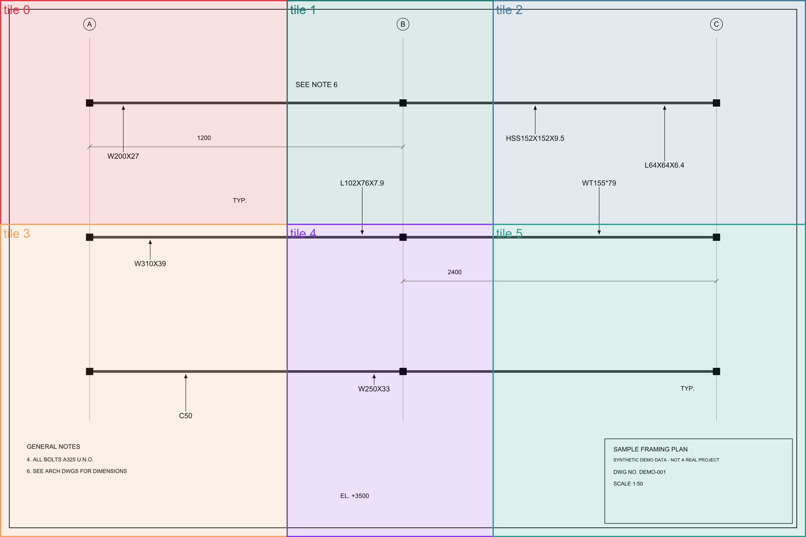
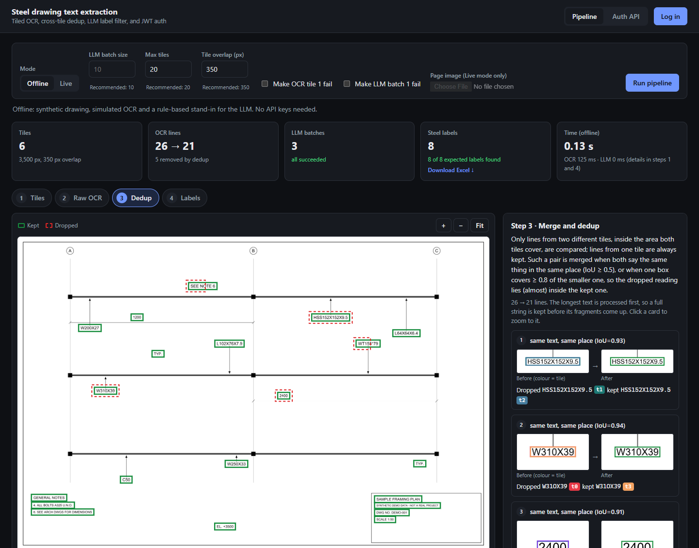

# Steel Drawing Text Extraction

[](https://github.com/raymond0122/steel-drawing-text-extraction/actions/workflows/ci.yml)

A standalone rebuild of my part of a capstone project: reading the text on structural steel drawings and picking out the steel section labels.

## Context

For my final-year capstone, a 4-person team built an 18-stage Python pipeline that turns structural steel drawing PDFs into a bill of materials for an industry sponsor. I owned two pieces:

- **The text-extraction layer:** tiled OCR with Azure Document Intelligence, merging results across tiles, and filtering steel section labels with an LLM.
- **JWT authentication** for the FastAPI backend.

The pipeline was not meant to be right on its own. It extracts as many labels as it can, and a person checks the result before it is used. The sponsor supplied drawings paired with their bill-of-materials spreadsheets, and we checked the pipeline's output against those.

The sponsor's drawings are confidential. So this repository re-implements my part from scratch and runs on a **synthetic drawing** instead. It contains no sponsor data and no code from my teammates' stages (vector parsing, CNN classification, label-to-component linking, the frontend). Compared with the capstone version, it adds automated tests and fixes a few issues; the full list is in [docs/DESIGN.md](docs/DESIGN.md#changes-in-this-version).

## How it works

```
page image ─► overlapping tiles ─► OCR per tile ─► merge + dedup ─► LLM label filter ─► labels with boxes
```

| Tiles (300 px overlap) | Final labels |
|---|---|
|  |  |

Duplicates and fragments created at tile edges, before and after merging:


## Quick start

```bash
git clone https://github.com/raymond0122/steel-drawing-text-extraction.git
cd steel-drawing-text-extraction
python -m venv .venv                           # Python 3.10 or newer
source .venv/Scripts/activate                  # Git Bash on Windows; PowerShell: .venv\Scripts\Activate.ps1; macOS/Linux: source .venv/bin/activate
pip install -e ".[dev]"                        # the app, plus pytest, ruff and mypy for development

steel-demo                                     # offline: synthetic drawing, simulated OCR and LLM, no API keys
python -m pytest                               # 76 tests
ruff check . && ruff format --check .          # lint and formatting (drop --check to apply it)
mypy                                           # type check, strict
uvicorn steel_text.web.server:app --reload     # web UI, then open http://127.0.0.1:8000
```

The demo (`steel-demo`, or `python -m steel_text.demo`) writes an image per step, `labels.json`, `labels.xlsx` (a label list, not a bill of materials) and `dedup_log.txt` to `out/`.

**Live mode** calls the real Azure and OpenAI services. Copy `.env.example` to `.env` in the repository root, fill in the keys, then run `steel-demo --live`, or `steel-demo --live --image page.png` for your own page image.

The web UI runs the same flow in the browser and shows each step on the drawing: tiles, raw OCR, dedup decisions and labels. A second tab exercises the auth API.



## Key design decisions

- **Built for human review, not a final answer.** Each label keeps its box on the drawing and the raw OCR text, so a reviewer can find it and see what the LLM corrected. In place of the sponsor's spreadsheets, the synthetic drawing comes with a ground-truth file, and the demo and web UI report which expected labels were found or missed.
- **Overlapping tiles.** Large drawings can exceed 10,000 px, and small text is missed when the page is sent whole. Tiles overlap by 300 px, so text cut at one tile's edge is complete in its neighbour.
- **Duplicates and cut-off pieces from tile edges are merged.** Text in an overlap band is read by two tiles, and text crossing an edge can come back cut off: one tile reads `"SEE"` while its neighbour reads `"SEE NOTE 6"`. Dedup keeps one full reading of each text and logs why it dropped the others. Only text that two different tiles read, inside the area both cover, is compared, so a label printed twice stays twice.
- **The LLM cannot invent locations.** Under a strict JSON schema it returns only an ID and a label. Boxes are joined back from the OCR results by ID, and IDs that weren't in the batch, or repeat, are dropped.
- **Transient errors are retried, bad LLM batches are skipped.** Azure calls retry on 429, 5xx and network errors, honouring `Retry-After` up to 60 s. A failed LLM batch is logged and the remaining batches continue.
- **Auth tokens cannot be swapped.** Access and refresh JWTs carry a `type` claim. Login gives the same error, in about the same time, for an unknown user and a wrong password.

Thresholds, retry rules and the web UI are described in [docs/DESIGN.md](docs/DESIGN.md).

## Known limitations

- **Text wider than the overlap** that crosses a tile edge may never be read whole by any tile.
- **One failed tile fails the page.** If an OCR tile still fails after its retries, the whole page fails rather than returning partial results.
- **No jitter in the backoff.**
- **LLM labels aren't validated** against a catalogue of standard steel sections.
- **Thresholds were set by hand**, without a systematic tuning method. The sponsor's drawing–spreadsheet pairs are confidential, so the only evaluation here is the synthetic drawing's ground truth.
- **No review step.** The web UI shows the results but cannot correct or approve them.
- **Tokens can't be revoked** (they are stateless), and passlib's default PBKDF2 iteration count is below current OWASP guidance.
- **The web UI is for local use only.** It has no access control of its own, and in live mode every run spends API credit.

## Layout

```
src/steel_text/   one package, installed with pip install -e .
  pipeline.py     the flow shared by the demo and the web UI, and its parts: geometry, tiling, dedup, Azure client,
                  tiled OCR, LLM filter, Excel label sheet, page loading, mocks, sample drawing, overlays
  settings.py     every setting the app reads, from the environment and .env
  http.py         the slice of an HTTP client the Azure and OpenAI clients use, so tests and the web UI can stand in
  auth/           FastAPI app, password hashing and JWT, SQLite user store
  web/            local web UI: a FastAPI server, its response models, and a single HTML page
  demo.py         the steel-demo command: runs the whole flow and writes images to out/
tests/            unit tests, an offline end-to-end test, and web API tests
docs/             design notes and README images
.github/          CI: ruff, mypy and pytest on every push to main and every pull request
pyproject.toml    dependencies, the steel-demo command, and the pytest, ruff and mypy settings
```
